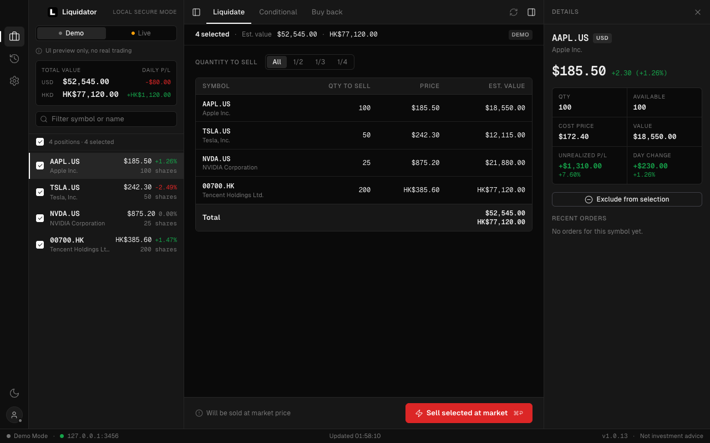
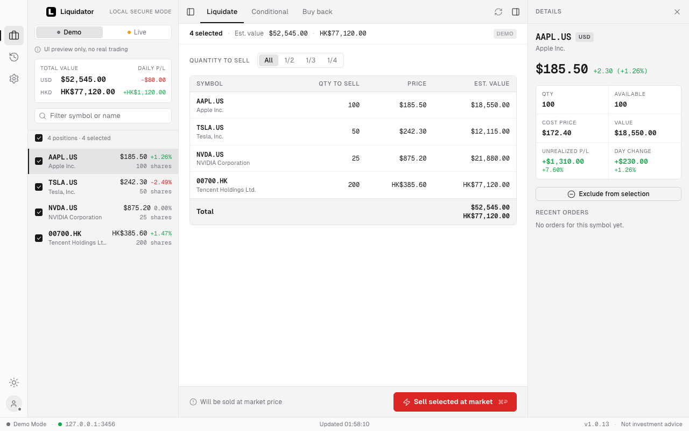
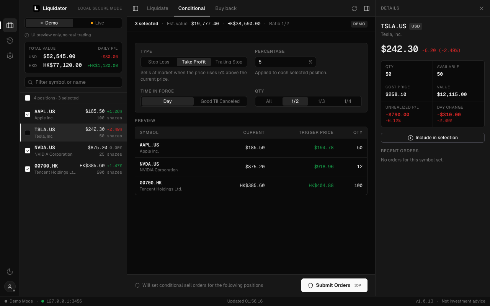
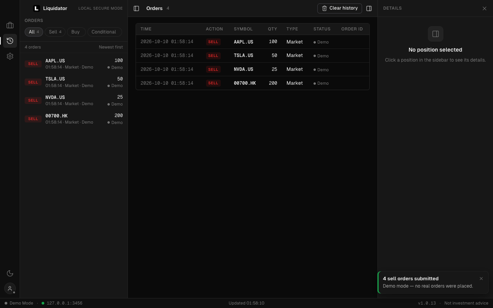
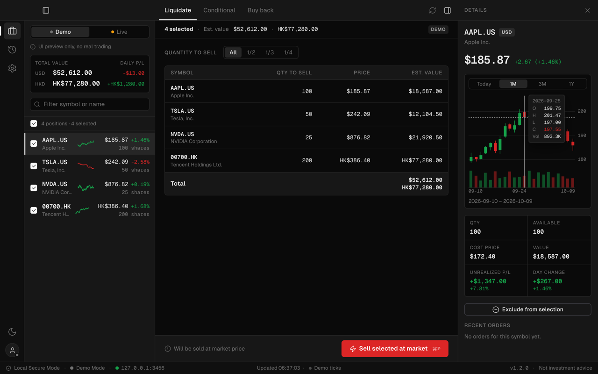
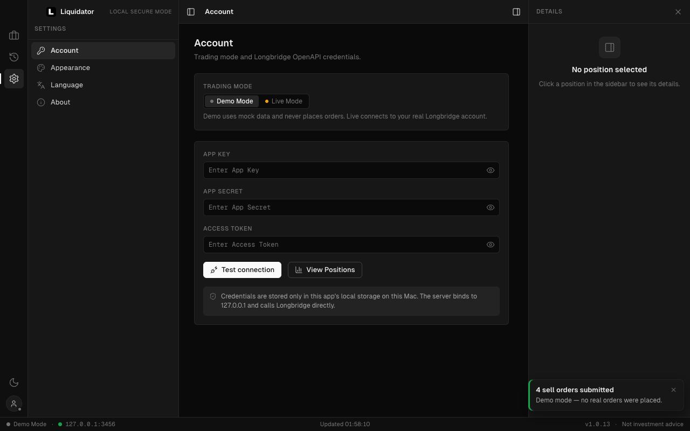

# LB Liquidator

> 长桥一键清仓工具 — 本地安全运行，支持 Web 与 Mac 原生应用
>
> One-click position liquidation tool for Longbridge — local-only, secure. Runs as a web app or native Mac app.


---

## Screenshots

| Dark Mode | Light Mode |
|-----------|------------|
|  |  |

| Conditional Sell | Order History |
|-----------------|---------------|
|  |  |

| Real-time Chart | Settings (Account) |
|-----------------|--------------------|
|  |  |

---

## Website

**Landing page:** https://liquidator.nowornever.work

---

## Features

- **Native desktop shell** — fixed-window layout like a Mac app: icon rail, positions sidebar, tabbed main view, details panel and status bar; overlay title bar, native menus, window size remembered
- **Local-only** — API credentials stored in local storage only, server binds to 127.0.0.1, UI and fonts bundled (no CDN requests)
- **Mac native app** — Tauri v2 wrapper, double-click to launch, no terminal needed
- **Auto-updates** — Sparkle-powered, checks for updates on launch + manual check via menu
- **Selective liquidation** — tick positions in the sidebar, sell at full / ½ / ⅓ / ¼ ratio
- **Conditional sell** — batch set take-profit, stop-loss, or trailing stop orders with a live trigger-price preview
- **Buy back** — re-buy what you just liquidated
- **Order history** — every order you submit is logged in the Orders view (stored locally), filterable by Sell / Buy / Conditional
- **Real-time chart and quotes** — the details panel charts the selected position (intraday line with volume and previous-close reference, or 1M / 3M / 1Y candles); prices refresh every 5 s with sparklines in the position list and a live indicator in the status bar. Polling pauses while the window is hidden or a dialog is open, and can be turned off in Settings → Account. Demo mode ticks synthetic prices
- **Live positions** — multi-currency (USD / HKD / SGD) totals, daily P/L, cost price and unrealized P/L in the details panel
- **Settings** — account and API credentials, appearance (System / Light / Dark), language, and About
- **Keyboard shortcuts** — ⌘R refresh, ⌘A select all, ⌘↩ confirm, ⌘, settings, ⌘B sidebar, ⌘D details, ⌘/ shortcuts, ⌘1/2/3 views, ⌘F filter
- **System theme** — follows macOS light / dark automatically, or pin one
- **i18n** — 简体中文 · 繁體中文 · English
- **Demo mode** — full UI preview with mock data, no real account needed

---

## Tech Stack

| Layer | Technology |
|-------|------------|
| Backend | Node.js + Express |
| Frontend | Vanilla HTML / CSS / JS (no bundler); CSS and scripts in `public/assets/`, shared `window.LB` namespace |
| Mac App | [Tauri v2](https://tauri.app/) (Rust + WKWebView) |
| Auto-update | [tauri-plugin-updater](https://github.com/tauri-apps/plugins-workspace) (Sparkle on macOS) |
| Trading SDK | [Longbridge OpenAPI Node.js SDK](https://www.npmjs.com/package/longport) |
| Icons | [Lucide](https://lucide.dev/) (bundled) |
| Fonts | [Geist](https://vercel.com/font) and Geist Mono (bundled) |

---

## How to Run

### Option 1: Mac App (Recommended)

Double-click to open — no terminal needed. The server starts automatically in the background.

**Prerequisites (one-time):**

```bash
# Install Rust
curl --proto '=https' --tlsv1.2 -sSf https://sh.rustup.rs | sh
source ~/.cargo/env
```

**Build:**

```bash
git clone https://github.com/therealechan/longbridge-liquidator-web.git
cd longbridge-liquidator-web

npm install
npx tauri build
```

Output:
```
src-tauri/target/release/bundle/macos/LB Liquidator.app
src-tauri/target/release/bundle/dmg/LB Liquidator_x.x.x_aarch64.dmg
```

> First build takes ~3–5 min (Rust compiling deps). Subsequent builds are fast.

**Dev mode (faster iteration):**

```bash
npm run tauri:dev
```

This starts the Express server (`npm start`) and opens the native window on `http://localhost:3456`. The UI is plain files in `public/assets/`, so there is no build step for frontend changes — restart `tauri dev` (or refresh the browser tab in web mode) to pick them up.

---

### Option 2: Web Mode

```bash
git clone https://github.com/therealechan/longbridge-liquidator-web.git
cd longbridge-liquidator-web
npm install
npm start
# → http://127.0.0.1:3456
```

Web mode shows the same UI in your browser. Native-only features (overlay title bar, menu bar, auto-update) are not available there, but all keyboard shortcuts work.

---

## Releases

Download the latest `.dmg` from the [Releases page](https://github.com/therealechan/longbridge-liquidator-web/releases).

The app updates itself automatically — on launch it checks for newer versions and prompts you to install. You can also trigger it manually via **LB Liquidator → Check for Updates…** in the menu bar.

---

## API Configuration

| Credential | Description |
|---|---|
| App Key | Application identifier |
| App Secret | Application secret |
| Access Token | API access token |

Enter them in **Settings → Account** (⌘,). Get credentials from [Longbridge Developer Center](https://open.longportapp.com/) → User Center → App Credentials.

> 📖 Docs: https://open.longportapp.com/docs

**Market data permissions:** chart and quote data come from your own Longbridge account, so what you see depends on its market-data permissions. For example, Hong Kong real-time quotes need an LV2 subscription; without it, HK data is delayed. If a market is not covered, the chart shows an "unavailable" message instead.

---

## Usage

1. Open **Settings** (⌘,) → **Account**, enter your Longbridge API credentials and click **Test connection**. Demo mode needs none.
2. Switch the sidebar to **Live** (Demo is the default) and positions load as soon as the server is up and credentials are saved; **⌘R** refreshes.
3. Tick the positions to operate on in the sidebar (all selected by default); click one to see its details (⌘D toggles the panel).
4. Pick a tab in the main view:
   - **Liquidate** — market sell selected positions at full / ½ / ⅓ / ¼
   - **Conditional** — batch set take-profit / stop-loss / trailing stop orders
   - **Buy back** — market buy back previously liquidated positions
5. Review the confirmation dialog and confirm with the button or **⌘↩**.
6. Open **Orders** (⌘2) to review everything submitted from this app.

Press **⌘/** any time for the shortcut list.

---

## Security

- API credentials stored in local storage (app or browser) — never leave your machine
- Server binds to `127.0.0.1` only — not accessible from the network
- Mac App embeds the UI and the server inside the `.app` bundle — zero network exposure; the UI loads no remote scripts, fonts or icons (strict CSP)
- The API accepts cross-origin calls only from the app's own origins (`tauri://localhost` and `localhost:3456`), never a wildcard
- Open source — audit the code yourself

---

## Disclaimer

**本工具仅供学习交流，投资有风险，操作需谨慎。**

This tool is for educational purposes only. Trading involves risk; proceed with caution.

---

## License

[MIT](LICENSE) © [Ed](https://github.com/therealechan)
